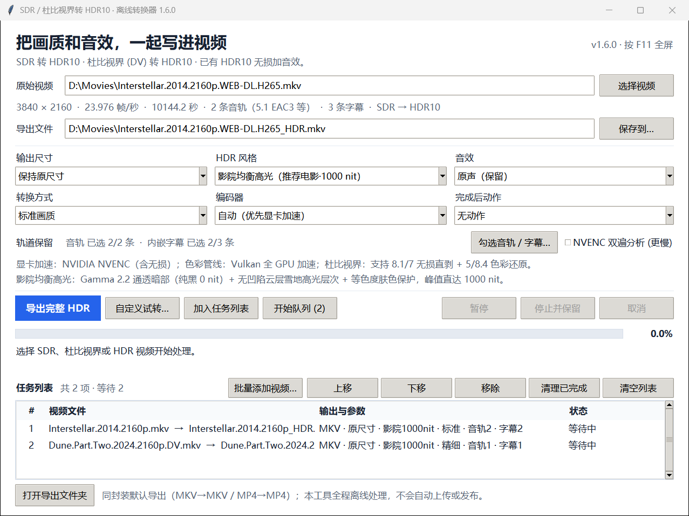

# SDR2HDR Desktop

一个面向 Windows 的离线视频转换工具：支持将普通 **SDR 视频** 和 **杜比视界（Dolby Vision Profile 5 / 7 / 8.1 / 8.4）** 转换为标准 **HDR10**，支持 NVIDIA / Intel / AMD 显卡硬件加速与 CPU 自动回退，提供四档画面编码、双声道虚拟环绕，以及自动逐帧校验的画面无损编码。



## 功能

- **SDR 转 HDR10（双风格可选）**：输出 HEVC Main 10、10-bit、PQ / BT.2020、MP4 / hvc1 视频——
  - **自然高光保护（默认，推荐电影实拍）**：在线性光下完成标准 `BT.709 → BT.2020` 色域映射与等色度高光保护曲线（峰值 `450 nits`、`MaxCLL/MaxFALL = 450/200`、`spline36` 色度采样），稳住肤色、额头与白衣高光细节，同时保持深邃黑位；
  - **高对比风格（原版，适合动漫与暗景）**：保留 v1.4 及以前的对数高对比曲线（`UV × 0.56`，暗部更沉、亮部更艳丽）。
- **杜比视界（DV）转 HDR10**：自动识别 Profile 5 / 7 / 8.1 / 8.4——
  - **Profile 8.1 / Profile 7（含 HDR10 兼容层）**：秒级无损直剥（不重编码，保留原生 10-bit HDR10 基础层并剥离 RPU／增强层，零画质损失，并兼容未标注容器矩阵的蓝光 Remux）；
  - **Profile 5（IPTPQc2，普通屏幕偏绿偏紫）与 Profile 8.4（HLG 杜比视界）**：通过 **Vulkan 硬解 + `libplacebo`** 进行杜比视界色彩还原，再由显卡硬编或 CPU 导出标准 HDR10。
- 支持 **NVIDIA NVENC / Intel QSV / AMD AMF** 10-bit 显卡硬编加速，并在显卡有损编码时自动启用 **Vulkan 硬解 + `libplacebo` GPU 色彩管线**（将色域转换、高光保护曲线与 10-bit 抖动移入 GPU 执行，不支持或无损/CPU 编码时无缝回退至 CPU 浮点滤镜）。
- 保持原尺寸和帧率，或选择短边 1440 / 2160 的输出尺寸。
- 提供快速、标准、精细、画面无损四种编码方式。
- 无损档自动比较编码前后每一帧的像素摘要，全部一致才保存最终文件。
- 可选双声道虚拟环绕；也可只给已有 HDR10 视频加音效，直接保留原视频轨道。
- 支持先试转 10 秒、**停止并保留已转片段**（优雅封包为可正常播放的 `*_已转片段.mp4`）、彻底取消任务、导出检查和转换记录。
- 离线运行，不自动上传视频，保留原文件。

## 开始使用

1. 在仓库的 **Releases** 页面下载 Windows 压缩包，解压后运行 `SDR2HDR.exe`。
2. 准备包含 `zscale`、`libx265`、`lut1d`、`lut3d`、`dovi_rpu`、`libplacebo` 等组件的较新完整 FFmpeg（若使用显卡硬编并写入 HDR10 静态元数据，需 FFmpeg 支持 `-mastering_display` / `-content_light` 及对应 `hevc_nvenc` / `hevc_qsv` / `hevc_amf`）。将其加入 `PATH`，或把 `ffmpeg.exe`、`ffprobe.exe` 放入程序旁的 `bin` 文件夹。
3. 选择 SDR 或杜比视界视频、导出位置、HDR 风格（默认“自然高光保护（推荐电影）”）、编码器（默认“自动（优先显卡加速）”）、转换方式和音效，先点击 **先试转 10 秒** 检查效果。
4. 点击 **导出完整 HDR**（或 **无损导出 HDR10**），等待转换和文件检查完成。

Windows 程序包已包含 Python 运行环境，无需另装 Python；FFmpeg 需要单独准备。

[完整使用指南](docs/usage.md) · [算法与输出规格](docs/algorithm.md) · [更新记录](CHANGELOG.md)

## 转换原理

SDR 转 HDR10 提供两种独立处理风格：

1. **自然高光保护（`natural`，默认）**：按 `BT.1886 (Gamma 2.4)` 解码至线性光并做标准 `BT.709 → BT.2020` 色域矩阵变换，依据 BT.2020 相对亮度 `Y` 施加同比例增益（`Y ≤ 0.62` 保持 `190·Y` 漫反射比例，`Y > 0.62` 按二次平滑曲线抬升至 `450 nits` 峰值），通过 `49³` 四面体插值 3D LUT（`lut3d`）与 `spline36` 色度处理输出 10-bit PQ / BT.2020，并写入与实际峰值匹配的 `MaxCLL = 450 / MaxFALL = 200` 元数据。三通道色度比例保持零偏移，在维持深黑位的同时避免实拍人脸额头、浅色皮肤与高光衣物过曝发白。
2. **高对比风格（`vivid`，原版）**：在非线性浮点 RGB 中施加 `U/V × 0.56` 色差增益与逐通道固定对数曲线 `q = 0.65 × ln(1 + 5 × max(x, 0)) / ln(6)`（上限 1000 尼特，中性白约 390.5 尼特），适合动漫与偏暗的高对比风格化呈现。

无论哪种风格，都不会凭空恢复原 SDR 片源已经剪裁或丢失的高光细节。

## 四档编码与硬件加速

程序默认自动选择已通过自检的显卡硬件编码器（优先级：`NVIDIA NVENC` > `Intel QSV` > `AMD AMF` > `CPU x265`），也可手动指定编码器：

- **快速试转**：CPU `x265 ultrafast / CRF 17`；NVENC `p2 / VBR CQ 22`；QSV `faster / ICQ 19`（支持时自动开启 `extbrc/mbbrc`）；AMF `speed / CQP 22`。
- **标准画质**：CPU `x265 fast / CRF 17`；NVENC `p5 / VBR CQ 20`；QSV `medium / ICQ 16`（支持时自动开启 `extbrc/mbbrc`）；AMF `balanced / CQP 20`。
- **精细画质**：CPU `x265 medium / CRF 16`；NVENC 默认高速单遍 `p6 / VBR CQ 18 / spatial-aq`（勾选“NVENC 双遍分析”或传 `--multipass` 时启用 `p7 + multipass qres`）；QSV `slow / ICQ 14`（支持时自动开启 `extbrc/mbbrc`）；AMF `quality / CQP 18`。
- **画面无损编码**：CPU 使用 `x265 lossless=1`；经自检支持的 NVIDIA NVENC 使用 `-tune lossless`；QSV 与 AMF 不支持 10-bit HEVC 无损，在“自动”模式下会自动切换为 CPU (`x265`)。无损档都会在导出后自动逐帧核对像素摘要。

四档采用相同的 HDR 像素处理规则。显卡硬编可显著缩短 2K / 4K 编码耗时；CPU `libx265` 在同体积下通常具有更高的压缩效率。无损档的文件可能明显大于原片，校验也需要更多时间。

**无损的范围是：HDR 处理后、进入编码器前的 10-bit YUV 4:2:0 画面，与导出视频解码后的画面逐帧一致。**它不表示 SDR 到 HDR 的全部处理可逆，也不保证音频无损。

## 播放与投稿

- 在支持 HDR 的屏幕和播放器中观看，按设备要求开启系统 HDR。
- 输出文件适合用作 HDR 视频素材；平台接收、转码和最终 HDR 档位需要实际投稿验证。
- 视频平台可能再次有损压缩，因此不能保证站内播放版本无损。
- HEVC 无损文件可能超出部分硬件解码器的支持范围，需要软件解码。
- 虚拟环绕通过声场扩展、短延迟和限幅处理双声道声音，输出仍是双声道 AAC。

## 源码运行

推荐使用 Python 3.13，最低 Python 版本为 3.10。运行时仅使用 Python 标准库；转换依赖外部 FFmpeg。

```powershell
python source/app.py
python source/hdr_core.py --list-encoders
python source/hdr_core.py --list-gpu-filter
python source/hdr_core.py --list-dv-tools
python source/hdr_core.py "input.mp4" "output_HDR.mp4" --style natural --encoder auto --quality standard
python source/hdr_core.py "input.mp4" "output_HDR_mp.mp4" --style natural --encoder nvenc --quality fine --multipass
python source/hdr_core.py "anime.mp4" "output_HDR_vivid.mp4" --style vivid --encoder auto --quality fine
python source/hdr_core.py "dolby_vision.mkv" "output_HDR10.mp4" --dv-mode auto
python source/hdr_core.py "input.mp4" "output_HDR_cpu.mp4" --encoder cpu --quality fine
python source/hdr_core.py "input.mp4" "output_lossless.mp4" --quality lossless
python source/hdr_core.py "input.mp4" "output_HDR_surround.mp4" --audio-effect surround
```

## 测试与构建

```powershell
python -m unittest discover -s source -p test_conversion.py -v
python -m pip install -r requirements-build.txt
python scripts/build_release.py
```

构建脚本会先运行集成测试，再生成 Windows 程序包及 SHA-256 校验文件。运行测试需要完整 FFmpeg；构建需要 Windows 和 PyInstaller。

## 许可证

项目代码采用 [MIT License](LICENSE)。Python、Tcl/Tk、PyInstaller 及外部音视频组件适用各自许可证，详见 [第三方说明](THIRD_PARTY_NOTICES.md)。
